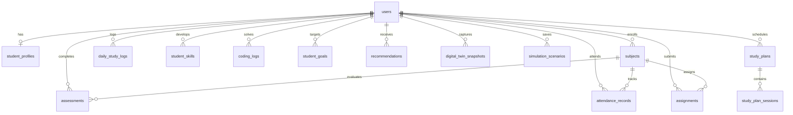

# Relational Database Schema — StudentOS

The database architecture is designed with strict relational integrity, indexed foreign keys, and student isolation.

---

## Table Definitions

### 1. `users`
Core user identity and authentication credentials.
- `id` (VARCHAR(36), PK): UUID primary key.
- `email` (VARCHAR(255), UNIQUE, INDEX): Login email address.
- `hashed_password` (VARCHAR(255)): Argon2 / bcrypt password hash.
- `is_active` (BOOLEAN): Account status flag.
- `created_at` (DATETIME): Timestamp of account registration.

### 2. `student_profiles`
Academic enrollment and student metadata.
- `id` (VARCHAR(36), PK): UUID.
- `user_id` (VARCHAR(36), FK -> users.id, UNIQUE): One-to-one link.
- `display_name` (VARCHAR(100)): Student full name.
- `institution`, `degree`, `branch`: College curriculum identifiers.
- `current_year` (INT), `current_semester` (INT), `expected_graduation_year` (INT).
- `current_cgpa` (FLOAT), `previous_semester_cgpa` (FLOAT), `target_cgpa` (FLOAT).
- `preferred_study_hours_per_day` (FLOAT): Target daily study volume.
- `primary_career_goal` (VARCHAR(100)): Desired industry specialization.
- `preferred_programming_language` (VARCHAR(50)).
- `technical_skill_level` (VARCHAR(50)).
- `weak_subjects`, `strong_subjects` (TEXT): Qualitative student reflection notes.
- `onboarding_completed` (BOOLEAN): Setup wizard completion flag.

### 3. `subjects`
Semester course curriculum registry.
- `id` (VARCHAR(36), PK): UUID.
- `user_id` (VARCHAR(36), FK -> users.id, INDEX).
- `name` (VARCHAR(150)): Course title (e.g. "Data Structures & Algorithms").
- `code` (VARCHAR(50), NULLABLE): Course catalog code (e.g. "CS301").
- `credits` (INT): Subject credit weighting (1 to 10).
- `semester` (INT): Associated semester number.
- `target_attendance` (FLOAT): Minimum attendance threshold (default 75.0%).
- `is_active` (BOOLEAN): Active semester indicator.

### 4. `assessments`
Internal exams, mid-terms, and quizzes.
- `id` (VARCHAR(36), PK): UUID.
- `user_id` (VARCHAR(36), FK -> users.id).
- `subject_id` (VARCHAR(36), FK -> subjects.id, INDEX).
- `name` (VARCHAR(150)): Assessment label (e.g. "Mid-Term Examination 1").
- `assessment_type` (VARCHAR(50)): "internal", "quiz", "assignment", "practical".
- `date` (DATE): Exam administration date.
- `marks_obtained` (FLOAT), `max_marks` (FLOAT).
- `percentage` (FLOAT): Computed score percentage.
- `weightage` (FLOAT, NULLABLE): Syllabus weighting.

### 5. `attendance_records`
Lecture and lab attendance records.
- `id` (VARCHAR(36), PK): UUID.
- `user_id` (VARCHAR(36), FK -> users.id).
- `subject_id` (VARCHAR(36), FK -> subjects.id, INDEX).
- `classes_conducted` (INT): Total lecture sessions delivered.
- `classes_attended` (INT): Total sessions attended by student.
- `percentage` (FLOAT): Attended / Conducted ratio.
- `date` (DATE): Tracking date.

### 6. `assignments`
Coursework deliverables and submission deadlines.
- `id` (VARCHAR(36), PK): UUID.
- `user_id` (VARCHAR(36), FK -> users.id).
- `subject_id` (VARCHAR(36), FK -> subjects.id, NULLABLE).
- `title` (VARCHAR(200)): Deliverable name.
- `due_date` (DATETIME): Submission deadline.
- `estimated_duration_hours` (FLOAT): Projected completion time.
- `priority` (VARCHAR(20)): "low", "medium", "high", "urgent".
- `status` (VARCHAR(20)): "not_started", "in_progress", "completed", "overdue".

### 7. `daily_study_logs`
Self-regulated study and focus diary.
- `id` (VARCHAR(36), PK): UUID.
- `user_id` (VARCHAR(36), FK -> users.id, INDEX).
- `date` (DATE): Log date.
- `total_study_hours` (FLOAT): Total non-classroom study time.
- `focus_rating` (INT): Self-reported focus score (1 to 5 scale).
- `dsa_problems_solved` (INT), `dsa_problems_attempted` (INT).
- `coding_practice_hours` (FLOAT).
- `subject_durations` (TEXT): JSON array of subject time breakdowns.

### 8. `student_skills`
Self-assessed competencies and gap tracking.
- `id` (VARCHAR(36), PK): UUID.
- `user_id` (VARCHAR(36), FK -> users.id).
- `name` (VARCHAR(100)): Skill name (e.g. "Dynamic Programming", "SQL").
- `category` (VARCHAR(50)): "Core CS", "AI/ML", "Web Dev", "Languages".
- `current_proficiency` (FLOAT), `target_proficiency` (FLOAT): 0-100% scale.
- `skill_gap` (FLOAT): Target - Current difference.

### 9. `coding_logs` & `student_goals`
DSA and competitive programming trackers.
- `coding_logs`: Tracks individual problem solutions, platforms (LeetCode, Codeforces), difficulty (Easy, Medium, Hard), status, and time spent.
- `student_goals`: Tracks quantifiable milestones with progress bars and target deadlines.

### 10. `digital_twin_snapshots` & `simulation_scenarios`
Digital Twin temporal state and What-If scenarios.
- `digital_twin_snapshots`: Records derived feature vectors, predicted CGPA, and risk levels across historical time steps.
- `simulation_scenarios`: Stores saved counterfactual simulations, modified parameters, and impact deltas.

### 11. `study_plans` & `study_plan_sessions`
Automated schedule generation.
- `study_plans`: Parent plan metadata (title, dates, total hours).
- `study_plan_sessions`: Child daily session breakdown with completion checkboxes.
